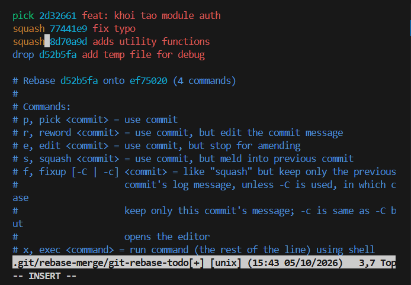
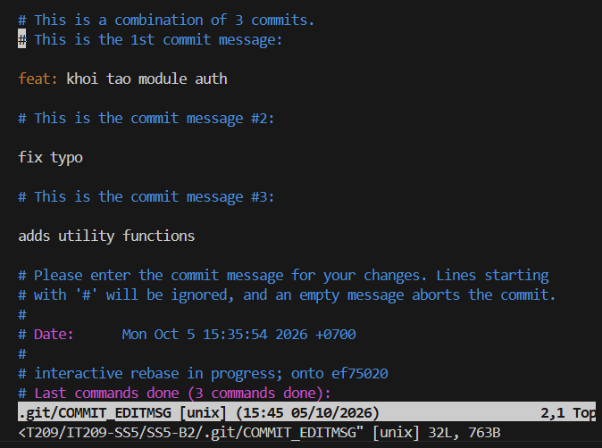
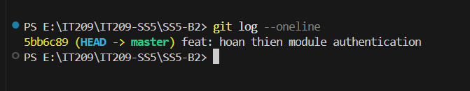

# Báo cáo Bài tập 2: Tái cấu trúc lịch sử commit bằng Interactive Rebase

## 1. Mục tiêu
- Sử dụng công cụ `git rebase -i` (Interactive Rebase) để làm sạch lịch sử commit cục bộ.
- Gộp các commit nhỏ lẻ (`squash`) thành 1 commit có ý nghĩa duy nhất.
- Đổi tên commit message (`reword` / squash message).
- Xóa bỏ commit không cần thiết (`drop`).

---

## 2. Các bước thực hiện

### Bước 1: Khởi chạy Interactive Rebase từ commit gốc
Do cần chỉnh sửa cả commit đầu tiên (commit gốc/root commit), sử dụng lệnh:
```bash
git rebase -i --root
```

### Bước 2: Cấu hình danh sách hành động (pick, squash, drop)
Trong trình soạn thảo, cấu hình các commit:
- Giữ nguyên commit đầu tiên: `pick 2d32661 feat: khoi tao module auth`
- Gộp 2 commit tiếp theo vào commit đầu: `squash 77441e9 fix typo` và `squash 8d70a9d adds utility functions`
- Xóa bỏ commit chứa file rác: `drop d52b5fa add temp file for debug`

**Ảnh chụp màn hình cấu hình Interactive Rebase:**





---

### Bước 3: Soạn thảo thông điệp commit sau khi gộp
Tại màn hình chỉnh sửa commit message gộp, đổi thành:
```text
feat: hoan thien module authentication
```

---

## 3. Kết quả sau khi hoàn tất

Kiểm tra lại lịch sử commit bằng lệnh:
```bash
git log --oneline
```

**Kết quả hiển thị:**
```text
5bb6c89 (HEAD -> master) feat: hoan thien module authentication
```

**Ảnh chụp màn hình kết quả kiểm tra `git log --oneline`:**

